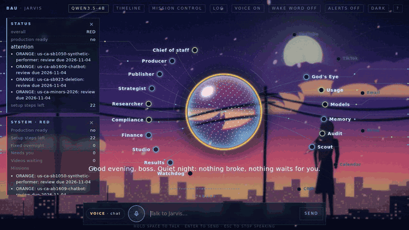
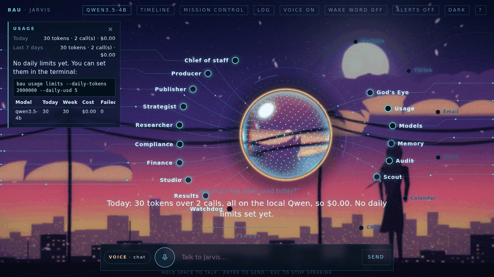
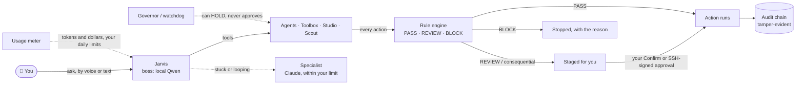
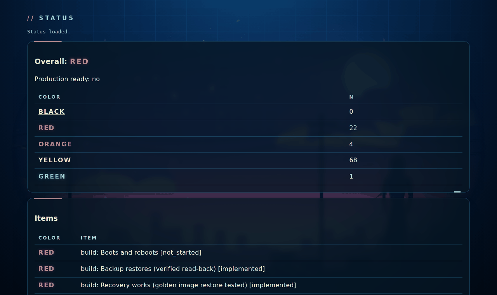

<div align="center">

<picture>
  <source media="(prefers-color-scheme: dark)" srcset="assets/hero-dark.svg">
  
</picture>



<p>
  <a href="https://github.com/BSAJabo258/linux-ai-biz/actions/workflows/ci.yml"></a>
  
  
  
  
  <a href="LICENSE"></a>
</p>

**[Quick start](#quick-start)** · **[Jarvis](#meet-jarvis)** · **[How it works](#how-it-works)** · **[Where it runs](#where-it-runs)** · **[The stick](#one-usb-stick)** · **[Docs](#documents)**

</div>

---

BAU/BSA is an AI business system for one owner. AI agents do the work, a rule engine checks it
against the law, and **you** decide anything that matters. Before BAU sends an email, texts
someone, publishes generated media, sells a subscription, monetizes an asset or moves money, it:

1. finds which rules apply **on that date, in that place**;
2. decides **PASS / REVIEW / BLOCK**;
3. records the evidence in a **tamper-evident audit chain**.

It runs from **one USB stick**: boot an 8 GB laptop, keep your work in encrypted storage on
the stick, and install BAU to the laptop's disk when you are ready. A small local model runs
Jarvis for free; Claude is on call when a job needs more.

<picture>
  <source media="(prefers-color-scheme: dark)" srcset="assets/features-dark.svg">
  
</picture>

<picture>
  <source media="(prefers-color-scheme: dark)" srcset="assets/stats-dark.svg">
  
</picture>

> [!IMPORTANT]
> BAU never claims to be "compliant" or "legally protected" (spec §121). It reports which
> requirements it identified, which controls ran, what evidence exists, and what is
> unresolved. Every regulation ships **awaiting counsel sign-off**, so nothing gets a clean
> PASS until a qualified human reviews it.

<picture>
  <source media="(prefers-color-scheme: dark)" srcset="assets/divider-dark.svg">
  
</picture>

## Meet Jarvis

Jarvis is the front door: a spoken briefing, conversation, and a live map of the business.
Each node is a part of the team (producer, scout, studio, watchdog and more) and lights up while
it works. Jarvis can look things up, draft and price things, but anything with consequences is
only **staged**: it runs when you press **Confirm**.

- **The glass mind.** A glass core in the middle bends the picture behind it like a lens. It
  breathes while Jarvis listens, glows while it thinks, and sends embers up while it speaks.
- **Living scenes.** Two hand-painted anime scenes (*dusk* and *summer*) are drawn live on the
  graphics card and melt into each other through the core about every 40 seconds. Add your
  own pictures with `bau look add`. On a slow or software-only graphics card the motion turns
  itself off and a still picture stays, so Jarvis never stutters.
- **Lean on small models.** On a local model (Qwen on the laptop) Jarvis offers only its core
  tools and keeps answers short, so a small model stays quick in 8 GB of memory. Claude is the
  specialist on call (`bau team`).
- **An honest meter.** Every model call is counted, free ones too, in tokens and dollars
  (`bau usage`), against the daily limits you set.

<details>
<summary><b>Still picture</b></summary>

</details>

### At the terminal

<picture>
  <source media="(prefers-color-scheme: dark)" srcset="assets/terminal-dark.svg">
  
</picture>

<picture>
  <source media="(prefers-color-scheme: dark)" srcset="assets/divider-dark.svg">
  
</picture>

## How it works



The **supervisor** watches every job: it stops loops, flags facts that no tool result backs,
and hands a stuck job to the specialist only within the daily limit you set. Tool results
reach the models wrapped as untrusted data, so a web page or an email can never give Jarvis
orders.

<picture>
  <source media="(prefers-color-scheme: dark)" srcset="assets/divider-dark.svg">
  
</picture>

## Where it runs

| | Where | Guide |
|---|---|---|
| 🔑 | **One USB stick** (recommended): boot an 8 GB laptop, encrypted storage on the stick, a local model, and Debian's installer to put BAU on the disk | [docs/LIVE-USB.md](docs/LIVE-USB.md) |
| 💻 | **Encrypted laptop**: hardened Debian + BAU, installed from the stick (or the older two-stick way) | [docs/INSTALL.md](docs/INSTALL.md) |
| ☁️ | **Your own cloud server** (DigitalOcean): Jarvis always on, reached through a private SSH tunnel | [docs/CLOUD-VM.md](docs/CLOUD-VM.md) |
| 🧪 | **Free test drive** in GitHub Codespaces with a free hosted model, or Docker on your computer | [docs/CLOUD-TEST.md](docs/CLOUD-TEST.md) |

> [!TIP]
> Not sure your laptop is ready? Run the read-only **laptop check** first: on Windows,
> double-click `installer/BAU-Laptop-Check.cmd`. It ends with READY, READY AFTER THESE STEPS,
> or NOT READY, plus a summary that is safe to share. See [docs/LAPTOP-CHECK.md](docs/LAPTOP-CHECK.md).

<picture>
  <source media="(prefers-color-scheme: dark)" srcset="assets/divider-dark.svg">
  
</picture>

## One USB stick

One stick does everything: it boots *My Jarvis*, keeps your work in encrypted storage, and
carries Debian's installer to put BAU on the laptop's disk.

| Step | What you do | Guide |
|---|---|---|
| 1. Build | On GitHub: **Actions → build-live → Run workflow** (no VS Code needed), then download the ISO from the release | [docs/BUILD-ISO.md](docs/BUILD-ISO.md) |
| 2. Write | balenaEtcher, or Rufus in DD mode | [docs/LIVE-USB.md](docs/LIVE-USB.md) |
| 3. Lock your keys | On your Windows computer, double-click `installer/BAU-Keys-Export.cmd`: your API keys go into one locked file, `BAU-KEYS.enc`. Only key *names* are ever shown | [docs/KEYS.md](docs/KEYS.md) |
| [docs/WINDOWS-TO-DEBIAN.md](docs/WINDOWS-TO-DEBIAN.md) | Every Windows script and what to use on Debian; the sound and Bluetooth fix |
| 4. Fill the BAU Pack | Double-click `installer/BAU-Pack-Make.cmd`: the local models (each pinned by its SHA-256) and `BAU-KEYS.enc` go on a stick you pick | [docs/PACK.md](docs/PACK.md) |
| 5. Set up | On the laptop, `sudo bau pack install`: checks every file again while copying and asks yes or no before each change (start the model, benchmark it, name the boss, import the keys) | [docs/PACK.md](docs/PACK.md) |
| 6. Make it yours | `bau look set dusk`, `summer` or your own picture; the desktop gets the same art | [docs/LOOK.md](docs/LOOK.md) |

**Steady on real laptops.** The stick turns off the laptop power-saving features known to
freeze some machines (screen self-refresh, USB autosuspend, PCIe power-down), and writes to
the stick in small steps so the system never stalls waiting on a slow USB drive.

**If something goes wrong,** press **Ctrl+Alt+F9**. The crash console shows, in large letters,
STICK GONE, DISK BUSY, MEMORY or HOT, plus the Wi-Fi and Bluetooth status and the last errors.
It keeps working even when the desktop has frozen. Take a photo of it; **Ctrl+Alt+F7** goes
back to the desktop.

<details>
<summary><b>Everything inside</b></summary>

- **The stick:** Debian 13 live system, BAU, llama.cpp, encrypted storage, Debian's installer
  with the BAU preseed, the crash console, the USB write guard, and the BAU wallpapers and
  dark theme.
- **The BAU control plane**, where compliance is part of the machine rather than a document beside it.
- **The work layers** that run on top of it:
  - Jarvis missions, agents as folders, and the team: a boss (local Qwen), a thinker for ideas
    and a specialist (Claude), watched by the supervisor;
  - the model router (Claude, local llama.cpp, hosted models with backups) and `bau models bench`;
  - MAYA memory, the Second Brain, Project Genesis and your chat library (`bau chats`);
  - the video studio, the kids series engine, ICM workspaces, publishing (YouTube, TikTok) and
    the results tracker;
  - God's Eye: public earthquakes, aircraft and satellites on a world map;
  - the toolbox (100 researched tools), Repo Scout and its weekly open-source watch;
  - the usage meter and your daily limits;
  - six business factories and the Opportunity Miner;
  - economics, accounting and sanctions screening;
  - a keyboard-first Mission Control dashboard.

</details>

<picture>
  <source media="(prefers-color-scheme: dark)" srcset="assets/divider-dark.svg">
  
</picture>

## Quick start

```bash
python3 -m pip install -e '.[dev]'
bau init                                   # BAU_HOME (default ~/.bau, or /var/lib/bau when installed)
bau reg validate                           # 49 regulations, 65 policies, all cross-references resolve
bau status --brief                         # honest production-readiness dashboard
bau jarvis                                 # Jarvis on http://127.0.0.1:8766
bau look show                              # the art behind Jarvis (bau look set summer to change it)
bau team show                              # who is boss, thinker and specialist
bau usage                                  # tokens and dollars per model today
bau toolbox ask "stop made-up answers"     # look up a researched tool before building one
bau ui                                     # Mission Control on http://127.0.0.1:8765
python3 -m pytest -q                       # full test suite
```

To use Claude models: `pip install 'bau[claude]'`, put your key in place (`sudo bau keys import`
on the laptop, or `ANTHROPIC_API_KEY` in `.env` for the test drive), then approve the model
yourself: `bau set-status model claude-opus-5-5 APPROVED`. A local model is approved only
after a real benchmark: `bau models bench`.

<details>
<summary><b>Build it yourself</b></summary>

```bash
bash image/build-live.sh --out /tmp/live                 # the one stick: Debian 13 live + BAU + llama.cpp
docker compose up -d --build                             # test drive: http://localhost:8765
installer/make-payload.sh --to /media/$USER/USB2         # older two-stick install: USB #2 payload
installer/build-usb-image.sh                             # older two-stick install: USB #1
```

How the *My Jarvis OS* spec maps onto this repository, and the build order:
**[docs/MY-JARVIS.md](docs/MY-JARVIS.md)**. Install runbook: **[docs/INSTALL.md](docs/INSTALL.md)**.

</details>

## Documents

**Getting started**

| Document | What it is |
|---|---|
| [docs/HANDOFF.md](docs/HANDOFF.md) | Where things stand and what is next |
| [docs/LAPTOP-CHECK.md](docs/LAPTOP-CHECK.md) | Is your laptop ready? A read-only check with a plain verdict |
| [docs/BUILD-ISO.md](docs/BUILD-ISO.md) | Build the stick from GitHub with one button, or with WSL + Docker |
| [docs/LIVE-USB.md](docs/LIVE-USB.md) | The one stick: write, boot, encrypted storage, local model, crash console, install to disk |
| [docs/PACK.md](docs/PACK.md) | The BAU Pack: local models and your keys on a stick, set up with yes/no questions |
| [docs/KEYS.md](docs/KEYS.md) | Bring your API keys over safely, locked in one file |
| [docs/INSTALL.md](docs/INSTALL.md) | Phase-by-phase install runbook |
| [docs/CLOUD-VM.md](docs/CLOUD-VM.md) | BAU and Jarvis on your own cloud server (DigitalOcean), reached through a private SSH tunnel |
| [docs/CLOUD-TEST.md](docs/CLOUD-TEST.md) | Free cloud test drive: GitHub Codespaces + a free hosted model, from a computer or iPhone |
| [docs/DEMO.md](docs/DEMO.md) | A five-minute demo you run yourself |
| [docs/DESKTOP.md](docs/DESKTOP.md) | The desktop edition: its own design for a PC with a graphics card (planned) |

**Jarvis and the team**

| Document | What it is |
|---|---|
| [docs/LOOK.md](docs/LOOK.md) | The BAU look: the glass core, the living anime scenes, your own pictures, the desktop |
| [docs/TEAM.md](docs/TEAM.md) | Boss, thinker and specialist; the supervisor that stops loops and checks facts |
| [docs/CONSTITUTION.md](docs/CONSTITUTION.md) | Your operating constitution: how Jarvis thinks and works for you |
| [docs/AGENT-FOLDERS.md](docs/AGENT-FOLDERS.md) | Agents as folders: instructions, skills and tools you can read and edit; you approve each one |
| [docs/USAGE.md](docs/USAGE.md) | See tokens and dollars per AI model, set your own daily limits |
| [docs/CHATS.md](docs/CHATS.md) | Your Claude and ChatGPT exports in one searchable library; you decide what Jarvis may share |
| [docs/RESEARCH.md](docs/RESEARCH.md) | Jarvis searches the web privately and reads pages; how to turn on private search |
| [docs/HANDS.md](docs/HANDS.md) | Jarvis does terminal jobs, one command at a time, each on your yes |
| [docs/TOOLBOX.md](docs/TOOLBOX.md) | Researched open-source tools Jarvis looks up before guessing; licences to watch |
| [docs/CAPABILITY-MAP.md](docs/CAPABILITY-MAP.md) | What Jarvis can do, what's missing, which tools fill each gap, and the build order |
| [docs/engineering/repo-intelligence.md](docs/engineering/repo-intelligence.md) | Repo Scout (`bau scout`) and the weekly open-source watch |
| [docs/GODS-EYE.md](docs/GODS-EYE.md) | God's Eye: earthquakes, aircraft and satellites on a world map in Jarvis; what it will never do |

**Making videos and money**

| Document | What it is |
|---|---|
| [docs/STUDIO.md](docs/STUDIO.md) | Make AI video clips (Higgsfield) inside a budget you set; priced first, made only on your Confirm |
| [docs/SERIES.md](docs/SERIES.md) | Kids series engine: the same characters and look in every clip; story formats; drift and sameness checks |
| [docs/WORKSPACES.md](docs/WORKSPACES.md) | Make an episode step by step: ICM workspaces (`bau ws`), you check every step |
| [docs/RESULTS.md](docs/RESULTS.md) | See views, earnings and profit for every posted video, and which formats work |

**Rules and design**

| Document | What it is |
|---|---|
| [docs/EMAIL_AND_MESSAGING_COMPLIANCE.md](docs/EMAIL_AND_MESSAGING_COMPLIANCE.md) | The exact order every commercial email and marketing text goes through, and what you must set up |
| [docs/REGULATORY_STATUS.md](docs/REGULATORY_STATUS.md) | What changed in the law through 2026-10-04, with sources |
| [docs/SPEC_GAP_ANALYSIS.md](docs/SPEC_GAP_ANALYSIS.md) | Loose ends, contradictions and missing laws found in the master spec, and how each was resolved |
| [docs/MY-JARVIS.md](docs/MY-JARVIS.md) | My Jarvis OS spec mapped onto this code, and the phase-by-phase build order |
| [docs/ARCHITECTURE.md](docs/ARCHITECTURE.md) | How the spec maps onto the code; decision model; identities |
| [docs/ARCHITECTURE_RFC.md](docs/ARCHITECTURE_RFC.md) | The executive controller prototype: one task, one adapter, one job |
| [docs/VM-USB-PLAN.md](docs/VM-USB-PLAN.md) | Test gates and rehearsal plan for the full OS and USB install |
| [docs/spec/BAU_MASTER_SPEC.md](docs/spec/BAU_MASTER_SPEC.md) | The master specification (v1.0) |

## Layout

```
src/bau/
  decision.py policy.py regulations.py jurisdiction.py    compliance engine
  gateway.py blast.py network.py datagov.py               Universal Gateway + its checks
  assistant.py ui/jarvis_server.py ui/jarvis.html         Jarvis: briefing, conversation, glass-mind screen
  team.py supervisor.py agents.py agentfolders.py         boss, thinker, specialist; loops stopped; agent folders
  models/       providers (Claude, llama.cpp, hosted), router, bench, fetch
  usage.py toolbox.py scout/                              usage meter, toolbox, Repo Scout + weekly watch
  pack.py keys.py look.py live.py                         BAU Pack, keys transfer, the look, stick storage
  studio.py series.py workspace.py publishing.py results.py   video, kids series, workspaces, posting, results
  memory.py genesis.py brain.py chats.py spatial.py       memory, Second Brain, chat library, God's Eye
  factories.py opportunity.py economics.py accounting.py sanctions.py
  comms/ commerce/ privacy/ security/                     email/SMS, subscriptions/IP/tax, DSR, trust
  audit.py evidence.py status.py governor.py cli.py cli_ext.py
  data/  regulations, policies, factories, toolbox, scout watch, series formats, agents
image/      build-live.sh, live-build/ (the one stick: crash console, USB guard, look, preseed)
installer/  laptop check, BAU Pack and keys export (Windows), payload/install.sh, cloud/
tests/      pytest suite
```

## Mission Control



A read-only dashboard at `http://127.0.0.1:8765`: status, missions, legal review, regulations,
jobs, economics, incidents, the Governor and the Second Brain. Changes and approvals happen at
the terminal with `bau`.

## Status

Every layer of spec §2 has working, tested code. `bau status` shows what only you can finish, and keeps reporting **not production-ready** until each item is done:
- counsel signs off each regulation;
- your sending domain's DNS records and the FCC wireless list are in place;
- a CPA fills in the tax rules;
- you approve the models and agents;
- the real storefront exists;
- the boot and restore drill passes on the laptop;
- the first real revenue mission completes.

Third-party projects plug in through adapters only after Repo Scout and Sentinel review, and
only when you say yes.
